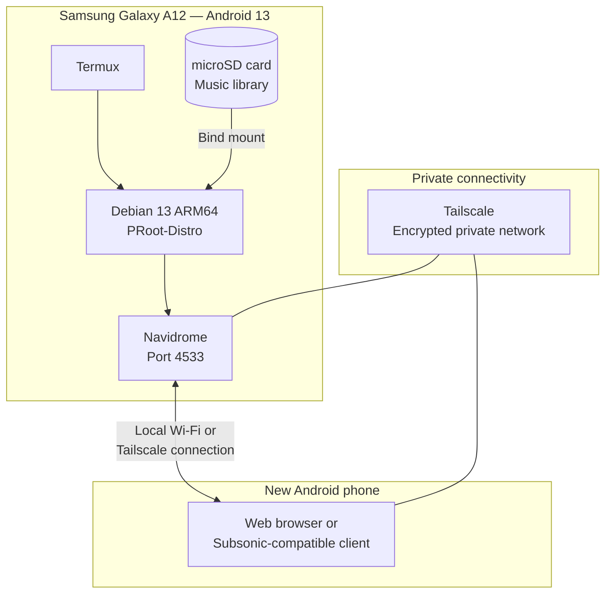

# Android Music Server — Navidrome on a Samsung Galaxy A12

A self-hosted music streaming server built using an old Android smartphone, Debian ARM64, Navidrome, and Tailscale.

The project turns a spare Samsung Galaxy A12 into a personal music server that streams a locally stored music collection to another Android device, both on the home network and remotely over the internet.

## Project status

**Working prototype — local and remote streaming tested successfully.**

| Component | Configuration |
|---|---|
| Server hardware | Samsung Galaxy A12 Nacho (SM-A127F/DSN) |
| Operating system | Android 13 |
| Server environment | Termux |
| Linux distribution | Debian 13 (Trixie) |
| Architecture | ARM64 / AArch64 |
| Media server | Navidrome 0.64.2 |
| Media storage | 32 GB microSD card |
| Audio processing | FFmpeg 7.1.5 |
| Remote connectivity | Tailscale |
| Streaming port | 4533 |

The project does not require root access or bootloader modifications.

## 1. Architecture

### System overview



### How it works

1. Android runs Termux, providing a Linux-like command-line environment.
2. PRoot-Distro runs Debian 13 ARM64 without replacing Android or requiring root.
3. Navidrome runs inside Debian and indexes the music collection.
4. The microSD card is exposed to Debian through a bind mount. Music files remain on the original storage.
5. Tailscale connects the server and client devices through a private encrypted network.
6. The client accesses Navidrome through its HTTP interface on port `4533`.

### Why these technologies?

- **Termux:** provides the terminal environment and Linux packages on Android.
- **PRoot-Distro:** provides a Debian userspace without installing a separate operating system.
- **Debian:** provides package management and a familiar Linux environment.
- **Navidrome:** lightweight, self-hosted music server with Subsonic-compatible APIs.
- **FFmpeg:** supports audio processing and media format handling.
- **Tailscale:** enables secure remote connectivity without public port forwarding.

## 2. Installation guide

### Requirements

- Android smartphone with a working battery.
- Termux installed from F-Droid or its official distribution source.
- Internet connection.
- microSD card or accessible storage containing music files.
- A second Android device for testing.
- No root access required.

### Step 1 — Install Termux

Install Termux from:

https://f-droid.org/packages/com.termux/

Open Termux and update its packages:

```bash
pkg update && pkg upgrade -y
```

Grant storage access:

```bash
termux-setup-storage
```

Accept the Android storage permission request.

### Step 2 — Install PRoot-Distro

```bash
pkg install proot-distro
```

Install Debian 13:

```bash
proot-distro install debian:13
```

Enter Debian:

```bash
proot-distro login debian
```

Verify the installation:

```bash
cat /etc/os-release
uname -m
```

Expected architecture:

```text
aarch64
```

### Step 3 — Install dependencies

Inside Debian:

```bash
apt update
apt full-upgrade -y
apt install -y curl wget ca-certificates ffmpeg
```

Verify FFmpeg:

```bash
ffmpeg -version
```

### Step 4 — Expose the microSD card to Debian

First, identify the actual microSD mount path in Termux. Android storage paths vary by device.

In this installation, the card was mounted at:

```text
/storage/0403-0201
```

The music collection was located at:

```text
/storage/0403-0201/Music
```

Create a mount destination inside Debian:

```bash
proot-distro login debian -- bash -c "mkdir -p /media/microsd"
```

Exit any existing Debian session and return to Termux.

Enter Debian with the microSD bind mount:

```bash
proot-distro login debian --bind /storage/0403-0201:/media/microsd
```

Verify access:

```bash
ls -la /media/microsd/Music
```

Check that MP3 files are readable:

```bash
find /media/microsd/Music -type f -iname "*.mp3" | head -10
```

**Important:** The bind mount must be supplied whenever Debian is launched for the server. Without it, Navidrome will not see the music directory.

### Step 5 — Download Navidrome

This installation uses Navidrome 0.64.2 for Linux ARM64.

Official releases:

https://github.com/navidrome/navidrome/releases

Download the Debian package:

```bash
mkdir -p /tmp/navidrome-download
cd /tmp/navidrome-download

wget -O navidrome.deb \
https://github.com/navidrome/navidrome/releases/download/v0.64.2/navidrome_0.64.2_linux_arm64.deb
```

Verify its SHA-256 checksum:

```bash
sha256sum navidrome.deb
```

Expected checksum:

```text
42d635a28d04c2753a68d503b937cfee1bb6c660ea50a14dd92140331ce2e100
```

Extract the package:

```bash
dpkg-deb -x navidrome.deb extracted
```

Check the executable:

```bash
extracted/usr/bin/navidrome --version
```

Expected output:

```text
0.64.2 (10114574)
```

### Step 6 — Install Navidrome

Install the executable:

```bash
install -Dm755 \
/tmp/navidrome-download/extracted/usr/bin/navidrome \
/usr/local/bin/navidrome
```

Create configuration and application data directories:

```bash
mkdir -p /etc/navidrome
mkdir -p /var/lib/navidrome
```

The Debian package is extracted rather than installed as a system service. This avoids depending on systemd, which is generally unavailable in this PRoot setup.

### Step 7 — Configure Navidrome

Create the configuration file:

```bash
nano /etc/navidrome/navidrome.toml
```

Configuration:

```toml
MusicFolder = "/media/microsd/Music"
DataFolder = "/var/lib/navidrome"

Address = "0.0.0.0"
Port = "4533"

ScanSchedule = "@every 1h"
LogLevel = "info"
```

Save the file.

Configuration explanation:

| Setting | Purpose |
|---|---|
| `MusicFolder` | Location of the music collection |
| `DataFolder` | Location of Navidrome's database and application data |
| `Address` | Listen on available network interfaces |
| `Port` | HTTP listening port |
| `ScanSchedule` | Automatically rescan the music collection every hour |
| `LogLevel` | Logging verbosity |

### Step 8 — Start Navidrome

Run:

```bash
navidrome --configfile /etc/navidrome/navidrome.toml
```

Keep the Termux session open.

On the server phone, open:

```text
http://127.0.0.1:4533
```

Create the initial administrator account and password.

Check that the library is indexed and that a track can be played.

### Step 9 — Test local network streaming

Connect both Android devices to the same Wi-Fi network.

Find the server phone's local IP address in:

**Android Settings → Connections → Wi-Fi → Connected network details**

On the client phone, open:

```text
http://SERVER_LOCAL_IP:4533
```

For example:

```text
http://192.168.1.105:4533
```

Sign in using the Navidrome credentials.

Verify album browsing and audio playback.

### Step 10 — Configure Tailscale

Install Tailscale on the server phone:

https://play.google.com/store/apps/details?id=com.tailscale.ipn

1. Sign in.
2. Approve the Android VPN connection.
3. Wait for the device to show as connected.

Install Tailscale on the client phone as well.

Sign in with the same account so both devices join the same tailnet.

Find the server's Tailscale IPv4 address in the Tailscale device list. It normally belongs to the `100.64.0.0/10` address range.

From the client phone, open:

```text
http://SERVER_TAILSCALE_IP:4533
```

Example:

```text
http://100.x.y.z:4533
```

To test remote access, turn off Wi-Fi on the client phone and use mobile data.

If the Navidrome interface loads and playback works, remote streaming is operational.

No router port forwarding is required.

## 3. Running the server

The current implementation starts Navidrome manually in the foreground.

A typical startup sequence is:

**In Termux:**

```bash
proot-distro login debian --bind /storage/0403-0201:/media/microsd
```

**Inside Debian:**

```bash
navidrome --configfile /etc/navidrome/navidrome.toml
```

Keep the session open while using the server.

If the process stops, streaming becomes unavailable until Navidrome is started again.

Automatic startup and recovery after Android restarts are planned improvements.

## 4. Security considerations

### Tailscale

Tailscale provides encrypted connectivity between authorized devices.

Security recommendations:

- Protect the Tailscale account with a strong password and multi-factor authentication where available.
- Only authorize devices that you control.
- Review the tailnet device list periodically.
- Remove devices that are no longer used.
- Avoid sharing Tailscale authentication credentials.

### Navidrome

Navidrome currently uses HTTP on port `4533`.

Remote traffic through Tailscale travels inside its encrypted network tunnel, but Navidrome itself is not configured for HTTPS.

Additional considerations:

- Do not expose port `4533` directly to the public internet.
- Avoid router port forwarding.
- Use a strong, unique Navidrome password.
- Keep Navidrome and Debian updated.
- Consider HTTPS through an appropriate Tailscale Serve configuration as a future improvement.

### Storage and credentials

- Do not commit passwords, authentication keys, or private Tailscale information to GitHub.
- Do not publish personal music files or copyrighted albums.
- Do not upload private server logs without reviewing them.
- Keep the music collection separate from the application database.

## 5. Troubleshooting

| Problem | Possible cause | Suggested solution |
|---|---|---|
| Debian cannot see music files | Missing bind mount | Re-enter Debian with the `--bind` argument |
| `Permission denied` when accessing storage | Android storage permission | Run `termux-setup-storage` and grant permission |
| Navidrome cannot find music | Incorrect `MusicFolder` path | Check `/media/microsd/Music` |
| Navidrome does not start | Configuration or executable problem | Inspect the terminal output and configuration |
| Local connection fails | Different Wi-Fi networks or wrong IP | Check both devices and the server's local IP |
| Remote connection fails | Tailscale disconnected | Check that both devices show as connected |
| Server stops responding | Android background restrictions or terminated process | Check Termux and Android battery settings |
| Artist artwork is missing | External metadata provider did not find the artist | Local playback and library indexing can still work |

### Useful diagnostic commands

Check Debian architecture:

```bash
uname -m
```

Check available storage:

```bash
df -h
```

Check FFmpeg:

```bash
ffmpeg -version
```

Check that music files are accessible:

```bash
find /media/microsd/Music -type f | head
```

Check Navidrome version:

```bash
navidrome --version
```

## 6. Limitations and future improvements

### Current limitations

- The server depends on the old smartphone remaining powered on.
- Android may restrict background processes.
- Navidrome currently runs in the foreground rather than as a managed system service.
- Remote availability depends on the internet connection and Tailscale connectivity.
- The current configuration uses HTTP rather than application-level HTTPS.
- The server's storage capacity is limited by the microSD card.

### Planned improvements

- [ ] Configure reliable automatic startup.
- [ ] Improve background-process reliability and battery management.
- [ ] Test a dedicated Subsonic-compatible Android client.
- [ ] Configure HTTPS access.
- [ ] Add basic monitoring and resource usage measurements.
- [ ] Document network latency and streaming performance.
- [ ] Test recovery after server and phone restarts.
- [ ] Add screenshots and a demonstration of the finished system.

## 7. Learning outcomes

This project provides practical experience with:

- Linux userspace environments on Android.
- ARM64 architecture and package deployment.
- Linux filesystem access and bind mounts.
- Service configuration and process management.
- Self-hosted applications.
- Local networking and TCP/IP.
- VPNs and secure remote connectivity.
- Storage management and application troubleshooting.

It also demonstrates how existing consumer hardware can be repurposed into a functional server without rooting or replacing its operating system.

## 8. References

- [Termux](https://termux.dev/)
- [PRoot-Distro](https://github.com/termux/proot-distro)
- [Debian](https://www.debian.org/)
- [Navidrome documentation](https://www.navidrome.org/docs/)
- [Navidrome releases](https://github.com/navidrome/navidrome/releases)
- [FFmpeg](https://ffmpeg.org/)
- [Tailscale documentation](https://tailscale.com/kb/)

---

**Project status:** Local and remote music streaming successfully tested on a Samsung Galaxy A12 using Navidrome, Debian 13, and Tailscale.
