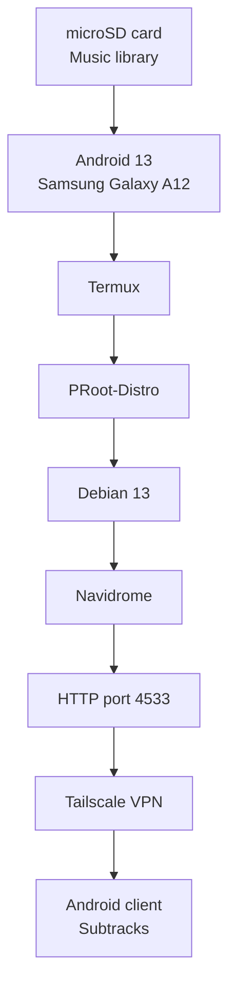

# Personal Music Server on Android

A personal music streaming server built using an old Samsung Galaxy A12, running Navidrome inside a Debian environment through Termux and PRoot-Distro.

The server streams a local music library to another Android phone over the home network or remotely through Tailscale. It uses an existing microSD music collection without reorganizing or copying the files.

## Project overview

The goal of this project is to repurpose an old Android phone into a low-power personal music server.

### Hardware and software

| Component | Details |
|---|---|
| Server device | Samsung Galaxy A12 Nacho (SM-A127F/DSN) |
| Operating system | Android 13 |
| Linux environment | Debian 13 (Trixie), ARM64 |
| Android terminal | Termux |
| Linux environment manager | PRoot-Distro |
| Music server | Navidrome 0.64.2 |
| Audio processing | FFmpeg 7.1.5 |
| Music storage | 32 GB microSD card |
| Remote access | Tailscale |
| Client application | Subtracks (Android) |
| Server port | 4533 |

## Architecture



The Android phone hosts the server. Termux provides a terminal environment, while PRoot-Distro runs Debian as a Linux userspace environment.

Debian is not a virtual machine: it shares the Android Linux kernel while providing its own userspace, package manager, libraries, and filesystem layout.

The microSD card is made accessible inside Debian through a PRoot bind mount.

## Installation and configuration

The following instructions describe the main setup. Paths and device-specific values may need to be adapted.

### 1. Install Termux

Install Termux from a trusted distribution source, such as F-Droid.

Termux and its add-ons should come from compatible distribution sources.

### 2. Install PRoot-Distro and Debian

Inside Termux:

```bash
pkg update && pkg upgrade
pkg install proot-distro
proot-distro install debian
```

Log into Debian:

```bash
proot-distro login debian
```

Update Debian:

```bash
apt update && apt upgrade
```

### 3. Install FFmpeg

Inside Debian:

```bash
apt install ffmpeg
```

### 4. Install Navidrome

Download the ARM64 Linux release of Navidrome from its official release page.

Place the executable at:

```text
/usr/local/bin/navidrome
```

Make it executable:

```bash
chmod +x /usr/local/bin/navidrome
```

Check the installed version:

```bash
navidrome --version
```

### 5. Make the microSD music library accessible

Find the microSD card's actual Android storage path. It commonly resembles:

```text
/storage/YOUR-SDCARD-ID
```

The identifier is device-specific. Replace `YOUR-SDCARD-ID` with the actual directory name.

Log into Debian with the card bound into the Linux environment:

```bash
proot-distro login debian --bind /storage/YOUR-SDCARD-ID:/media/microsd
```

The music library should then be accessible inside Debian at:

```text
/media/microsd/Music
```

The original music files remain on the microSD card.

### 6. Configure Navidrome

Create the configuration directory and file:

```bash
mkdir -p /etc/navidrome
nano /etc/navidrome/navidrome.toml
```

Example configuration:

```toml
MusicFolder = "/media/microsd/Music"
DataFolder = "/var/lib/navidrome"

Address = "0.0.0.0"
Port = 4533

Scanner.Schedule = "@every 1h"
LogLevel = "info"
```

Create the data directory:

```bash
mkdir -p /var/lib/navidrome
```

Start Navidrome:

```bash
navidrome --configfile /etc/navidrome/navidrome.toml
```

Open the web interface on the server phone:

```text
http://127.0.0.1:4533
```

Create the administrator account through the web interface.

### 7. Configure remote access with Tailscale

Install Tailscale on both Android phones and sign in to the same tailnet.

Enable Tailscale on the server phone and note its Tailscale IP address.

The client can connect to:

```text
http://SERVER-TAILSCALE-IP:4533
```

Replace `SERVER-TAILSCALE-IP` with the server phone's actual Tailscale IP address.

No router port forwarding is required.

The Tailscale tunnel encrypts traffic between devices. The HTTP connection is not independently encrypted outside that tunnel.

### 8. Install and configure Subtracks

Install Subtracks on the client Android phone.

Add the Navidrome server using the server's address and port:

```text
http://SERVER-TAILSCALE-IP:4533
```

Enter the Navidrome account credentials.

Subtracks communicates with Navidrome through the Subsonic API.

## Automatic startup

The server is configured to start automatically after the Android phone boots.

Termux:Boot is used to execute a startup script.

Install the Termux:Boot Android application from the same distribution source as Termux.

Create the boot script directory:

```bash
mkdir -p ~/.termux/boot
```

The startup script is located at:

```text
~/.termux/boot/start-music-server.sh
```

The script starts the Debian environment with the microSD bind mount and launches Navidrome.

The phone must be unlocked after a reboot before Android allows the relevant storage and application processes to operate normally.

Tailscale is configured to reconnect automatically using Android's Always-on VPN setting and unrestricted battery usage.

## Monitoring

A monitoring script runs periodically through Android's JobScheduler using Termux:API.

### Required components

Both components are needed:

1. Install the Termux:API Android companion application from the same distribution source as Termux.
2. Install the command-line package:

```bash
pkg install termux-api
```

Test the integration:

```bash
termux-battery-status
```

### Monitoring script

The monitoring script is located at:

```text
~/bin/monitor-music-server.sh
```

It checks:

- Whether the microSD music directory is accessible.
- Whether the Navidrome process is running.
- Whether the Navidrome HTTP endpoint responds successfully.
- Available storage in the relevant locations.

It records normal status and warnings in:

```text
~/monitor.log
```

Storage warnings are configured at:

| Condition | Threshold |
|---|---:|
| Warning | 90% used |
| Critical | 95% used |

The monitor does not automatically restart Navidrome or send remote notifications.

### JobScheduler configuration

The monitoring job uses Job ID `4533`, a requested period of `900000` milliseconds (15 minutes), and persisted scheduling.

The Android JobScheduler may defer execution due to Doze mode, battery conditions, or system scheduling decisions. The requested interval is not a guarantee of execution every 15 minutes.

The job was registered without an explicit network constraint. Its default network setting is `any`.

The battery-not-low constraint is enabled by default when it is not explicitly disabled.

## Logging and log rotation

The project uses separate logs for different processes:

| Log file | Purpose |
|---|---|
| `~/navidrome.log` | Navidrome output |
| `~/navidrome-boot.log` | Startup script output |
| `~/monitor.log` | Monitoring results |

Log rotation is configured using `logrotate`.

Configuration file:

```text
~/.config/logrotate.conf
```

State file:

```text
~/.local/state/logrotate.status
```

Configured behavior:

- Navidrome log rotation threshold: 1 MB.
- Monitoring and boot log rotation threshold: 256 KB.
- Retain three archived logs.
- Compress rotated logs.
- Use `copytruncate` for the Navidrome log.

The configuration has been installed and dry-run validated. Actual threshold-triggered archive creation should be tested separately before considering log rotation fully verified.

## Stopping the server

A separate stop script is located at:

```text
~/bin/stop-music-server.sh
```

It is used to stop the Navidrome process without manually searching for and terminating it.

## Security considerations

- Remote access is provided through Tailscale.
- No router port forwarding is configured.
- Tailscale encrypts traffic between devices in the tailnet.
- Navidrome listens on `0.0.0.0`, meaning it binds to all available network interfaces.
- The server uses HTTP rather than independently configured HTTPS.
- HTTP traffic on the local network is not independently encrypted. Remote traffic carried through Tailscale is encrypted by the VPN tunnel.
- Server credentials and private configuration files should never be committed to the public repository.

## Troubleshooting

### Navidrome cannot find the music library

Check that the microSD card is mounted and that the bind mount points to the correct Android storage directory.

Inside Debian:

```bash
ls /media/microsd/Music
```

### The server is not reachable

Check that Navidrome is running and listening on port `4533`.

Test locally:

```bash
curl -I http://127.0.0.1:4533
```

For remote access, verify that Tailscale is connected on both devices.

### The server does not start after reboot

Check that:

- Termux:Boot is installed.
- Termux:Boot has been opened at least once.
- The startup script is in `~/.termux/boot/`.
- The startup script has executable permissions.
- The Android phone has been unlocked after reboot.

### Monitoring does not run at the expected interval

Android JobScheduler controls when the job executes. Doze mode and battery conditions can delay execution.

Check the job registration and Termux:API installation.

## Limitations

- The server depends on the Android phone remaining powered on.
- Android may restrict background execution.
- Performance and reliability depend on the phone's hardware and network connection.
- The microSD card must remain accessible.
- The monitoring system does not currently restart the server automatically.
- No remote alerting system is configured.
- HTTPS is not independently configured on Navidrome.

## Possible future improvements

- Configure HTTPS using Tailscale Serve.
- Add remote monitoring notifications.
- Monitor CPU, memory, and device temperature.
- Measure streaming performance and network latency.
- Add controlled recovery if Navidrome unexpectedly stops.
- Test log rotation under controlled conditions.
- Add screenshots and sanitized configuration examples.
- Publish selected scripts in the repository.

## Learning outcomes

This project provides practical experience with:

- Linux command-line administration.
- Debian package management.
- Android and Linux userspace environments.
- Process management and startup automation.
- Network services and HTTP.
- VPN-based remote access.
- Shell scripting and system monitoring.
- Log management and rotation.
- Configuration management and technical documentation.

## Repository structure

```text
music-server/
├── README.md
├── .gitignore
├── LICENSE
└── config/
    └── navidrome.example.toml
```

## References

- [Navidrome documentation](https://www.navidrome.org/docs/)
- [Navidrome GitHub repository](https://github.com/navidrome/navidrome)
- [Termux documentation](https://termux.dev/en/)
- [PRoot-Distro documentation](https://github.com/termux/proot-distro)
- [Tailscale documentation](https://tailscale.com/kb/)
- [Subtracks GitHub repository](https://github.com/austinried/subtracks)
- [Termux:Boot on F-Droid](https://f-droid.org/packages/com.termux.boot/)
- [Subtracks on F-Droid](https://f-droid.org/packages/com.subtracks/)
