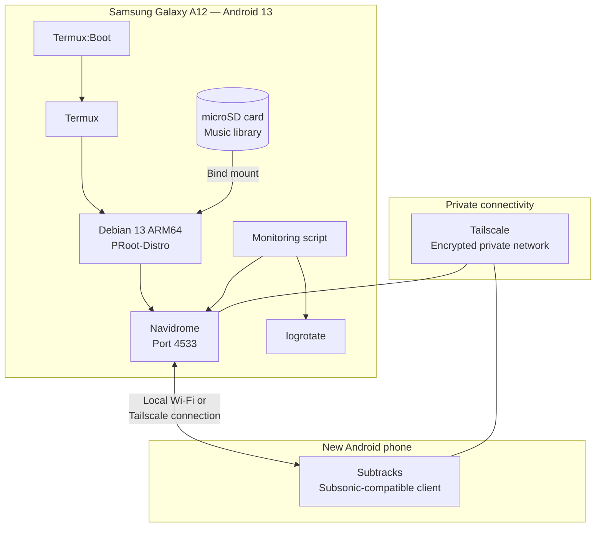

# Android Music Server — Navidrome on a Samsung Galaxy A12

A self-hosted music streaming server built using an old Android smartphone, Debian ARM64, Navidrome, and Tailscale.

The project turns a spare Samsung Galaxy A12 into a personal music server that streams a locally stored music collection to another Android device, both on the home network and remotely over the internet.

The system runs without root access, bootloader modifications, or router port forwarding.

## Project status

**Operational prototype — local and remote streaming, automatic startup, and periodic monitoring successfully tested.**

| Component | Configuration |
|---|---|
| Server hardware | Samsung Galaxy A12 Nacho (SM-A127F/DSN) |
| Operating system | Android 13 |
| Server environment | Termux |
| Linux distribution | Debian 13 (Trixie) |
| Architecture | ARM64 / AArch64 |
| Media server | Navidrome 0.64.2 |
| Media storage | 32 GB microSD card |
| Audio processing | FFmpeg 7.1.5 |
| Remote connectivity | Tailscale |
| Android client | Subtracks |
| Streaming port | 4533 |
| Process startup | Termux:Boot |
| Monitoring | Termux:API and Android JobScheduler |
| Log management | logrotate |

Implemented features:

- Local and remote music streaming.
- Direct access to the existing music library on the microSD card.
- Automatic Navidrome startup after Android reboots.
- Automatic Tailscale reconnection.
- Periodic server health checks.
- Internal storage and microSD storage monitoring.
- Automatic log rotation.

The system has been reboot-tested without manually launching the server.

---

## 1. Architecture

### System overview



### How it works

1. Android runs Termux, providing a Linux-like command-line environment.
2. PRoot-Distro runs Debian 13 ARM64 without replacing Android or requiring root.
3. Navidrome runs inside Debian and indexes the music collection.
4. The microSD card is exposed to Debian through a bind mount. Music files remain on the original storage.
5. Tailscale connects the server and client devices through a private encrypted network.
6. The client accesses Navidrome through its HTTP interface on port `4533`.
7. Termux:Boot starts the server automatically after Android boots.
8. Android JobScheduler periodically executes a monitoring script.
9. logrotate manages application and monitoring logs.

### Why these technologies?

- **Termux:** provides the terminal environment and Linux packages on Android.
- **PRoot-Distro:** provides a Debian userspace without installing a separate operating system.
- **Debian:** provides package management and a familiar Linux environment.
- **Navidrome:** lightweight, self-hosted music server with Subsonic-compatible APIs.
- **FFmpeg:** supports audio processing and media format handling.
- **Tailscale:** enables secure remote connectivity without public port forwarding.
- **Termux:Boot:** starts server processes automatically after device boot.
- **Termux:API:** exposes Android functionality to Termux applications.
- **logrotate:** manages log file sizes and archived logs.

---

## 2. Installation guide

### Requirements

- Android smartphone with a working battery.
- Termux installed from F-Droid or its official distribution source.
- Internet connection.
- microSD card or accessible storage containing music files.
- A second Android device for testing.
- No root access required.

### Step 1 — Install Termux

Install Termux from:

https://f-droid.org/packages/com.termux/

Open Termux and update its packages:

```bash
pkg update && pkg upgrade -y
```

Grant storage access:

```bash
termux-setup-storage
```

Accept the Android storage permission request.

### Step 2 — Install PRoot-Distro

```bash
pkg install proot-distro
```

Install Debian 13:

```bash
proot-distro install debian:13
```

Enter Debian:

```bash
proot-distro login debian
```

Verify the installation:

```bash
cat /etc/os-release
uname -m
```

Expected architecture:

```text
aarch64
```

### Step 3 — Install dependencies

Inside Debian:

```bash
apt update
apt full-upgrade -y
apt install -y curl wget ca-certificates ffmpeg
```

Verify FFmpeg:

```bash
ffmpeg -version
```

### Step 4 — Expose the microSD card to Debian

First, identify the actual microSD mount path in Termux. Android storage paths vary by device.

In this installation, the card was mounted at:

```text
/storage/0403-0201
```

The music collection was located at:

```text
/storage/0403-0201/Music
```

Create a mount destination inside Debian:

```bash
proot-distro login debian -- bash -c "mkdir -p /media/microsd"
```

Exit any existing Debian session and return to Termux.

Enter Debian with the microSD bind mount:

```bash
proot-distro login debian --bind /storage/0403-0201:/media/microsd
```

If your microSD card has a different mount path, replace `/storage/0403-0201` with your actual path.

Verify access:

```bash
ls -la /media/microsd/Music
```

Check that MP3 files are readable:

```bash
find /media/microsd/Music -type f -iname "*.mp3" | head -10
```

**Important:** The bind mount must be supplied whenever Debian is launched for the server. Without it, Navidrome will not see the music directory.

### Step 5 — Download Navidrome

This installation uses Navidrome 0.64.2 for Linux ARM64.

Official releases:

https://github.com/navidrome/navidrome/releases

Download the Debian package:

```bash
mkdir -p /tmp/navidrome-download
cd /tmp/navidrome-download

wget -O navidrome.deb \
https://github.com/navidrome/navidrome/releases/download/v0.64.2/navidrome_0.64.2_linux_arm64.deb
```

Verify its SHA-256 checksum:

```bash
sha256sum navidrome.deb
```

Expected checksum:

```text
42d635a28d04c2753a68d503b937cfee1bb6c660ea50a14dd92140331ce2e100
```

Extract the package:

```bash
dpkg-deb -x navidrome.deb extracted
```

Check the executable:

```bash
extracted/usr/bin/navidrome --version
```

### Step 6 — Install Navidrome

Install the executable:

```bash
install -Dm755 \
/tmp/navidrome-download/extracted/usr/bin/navidrome \
/usr/local/bin/navidrome
```

Create configuration and application data directories:

```bash
mkdir -p /etc/navidrome
mkdir -p /var/lib/navidrome
```

The Debian package is extracted rather than installed as a system service. This avoids depending on systemd, which is generally unavailable in this PRoot setup.

### Step 7 — Configure Navidrome

Create the configuration file:

```bash
nano /etc/navidrome/navidrome.toml
```

Configuration:

```toml
MusicFolder = "/media/microsd/Music"
DataFolder = "/var/lib/navidrome"

Address = "0.0.0.0"
Port = 4533

Scanner.Schedule = "@every 1h"
LogLevel = "info"
```

Save the file.

Configuration explanation:

| Setting | Purpose |
|---|---|
| `MusicFolder` | Location of the music collection |
| `DataFolder` | Location of Navidrome's database and application data |
| `Address` | Listen on available network interfaces |
| `Port` | HTTP listening port |
| `Scanner.Schedule` | Automatically rescan the music collection every hour |
| `LogLevel` | Logging verbosity |

### Step 8 — Start Navidrome manually

Enter Debian with the microSD bind mount:

```bash
proot-distro login debian --bind /storage/0403-0201:/media/microsd
```

Inside Debian, run:

```bash
navidrome --configfile /etc/navidrome/navidrome.toml
```

On the server phone, open:

```text
http://127.0.0.1:4533
```

Create the initial administrator account and password.

Check that the library is indexed and that a track can be played.

### Step 9 — Test local network streaming

Connect both Android devices to the same Wi-Fi network.

Find the server phone's local IP address in:

**Android Settings → Connections → Wi-Fi → Connected network details**

On the client phone, open:

```text
http://SERVER_LOCAL_IP:4533
```

For example:

```text
http://192.168.1.105:4533
```

Sign in using the Navidrome credentials.

Verify album browsing and audio playback.

### Step 10 — Configure Tailscale

Install Tailscale on the server phone:

https://play.google.com/store/apps/details?id=com.tailscale.ipn

1. Sign in.
2. Approve the Android VPN connection.
3. Wait for the device to show as connected.

Install Tailscale on the client phone as well.

Sign in with the same account so both devices join the same tailnet.

Find the server's Tailscale IPv4 address in the Tailscale device list. It normally belongs to the `100.64.0.0/10` address range.

From the client phone, open:

```text
http://SERVER_TAILSCALE_IP:4533
```

To test remote access, turn off Wi-Fi on the client phone and use mobile data.

If the Navidrome interface loads and playback works, remote streaming is operational.

No router port forwarding is required.

### Step 11 — Configure the Android music client

This project uses Subtracks, an Android music player compatible with Navidrome through the Subsonic API.

Subtracks is available through F-Droid:

https://f-droid.org/packages/com.subtracks/

Configure the server connection using:

- Server address: the server's Tailscale IP address.
- Port: `4533`.
- Username and password: the Navidrome account credentials.

The same Tailscale address can be used both at home and remotely, provided Tailscale is connected on both devices.

Playback, queue management, and background playback were tested successfully.

---

## 3. Automatic startup and process management

The server is configured to start automatically when the Android device boots.

This is implemented using Termux:Boot and a startup script located at:

```text
~/.termux/boot/start-music-server.sh
```

Install Termux:Boot from F-Droid:

https://f-droid.org/packages/com.termux.boot/

Open Termux:Boot at least once after installation.

The startup script performs the following operations:

1. Acquires a Termux wake lock to reduce the risk of Android suspending the server process.
2. Waits for the microSD card to become accessible.
3. Checks whether an existing server instance is running.
4. Starts Navidrome inside the Debian PRoot environment with the microSD bind mount.
5. Waits for the HTTP endpoint to become available.
6. Writes startup diagnostics to a dedicated log.

The script also checks for an existing server process to avoid starting duplicate instances.

### Shutdown script

A separate shutdown script is available at:

```text
~/bin/stop-music-server.sh
```

It identifies the expected PRoot launcher and Navidrome child process, sends Navidrome a termination signal, and waits for the launcher to exit.

It also releases the Termux wake lock after a successful shutdown.

### Android battery configuration

For reliable background operation:

- Termux battery usage: Unrestricted.
- Termux:Boot battery usage: Unrestricted.
- Tailscale battery usage: Unrestricted.
- Tailscale configured as Android's always-on VPN.
- Termux:Boot installed and opened at least once.

The startup process and Tailscale reconnection have been tested after reboot without manually launching either application.

---

## 4. Monitoring

A monitoring script periodically checks the server's operational state.

Script location:

```text
~/bin/monitor-music-server.sh
```

### Health checks

| Check | Description |
|---|---|
| Music directory | Verifies that the microSD music directory is accessible |
| Navidrome process | Checks the PRoot launcher and Navidrome process |
| HTTP endpoint | Checks whether Navidrome responds on port 4533 |
| Internal storage | Monitors available Android internal storage |
| microSD storage | Monitors available microSD storage |

The HTTP check accepts successful responses and redirects, such as HTTP 302, as evidence that the server is responding.

### Storage warning thresholds

| Storage usage | Status |
|---|---|
| Below 90% | Normal |
| 90%–94% | Warning |
| 95% or above | Critical |

The monitoring script checks both internal Android storage and the microSD card.

The script only reports problems. It does not automatically restart the server or send remote notifications.

### Periodic execution

Monitoring is scheduled using Android JobScheduler through Termux:API.

The Termux:API package and the separate Termux:API Android companion application are both required.

Configuration:

| Setting | Value |
|---|---|
| Job ID | `4533` |
| Requested interval | 15 minutes |
| Persistent across reboots | Enabled |
| Network requirement | No specific network requirement |

The job is registered using:

```bash
termux-job-scheduler \
  --script "$HOME/bin/monitor-music-server.sh" \
  --job-id 4533 \
  --period-ms 900000 \
  --persisted true
```

Check pending jobs:

```bash
termux-job-scheduler --pending
```

Android may delay scheduled executions because of battery optimization and Doze mode. Therefore, the 15-minute interval is approximate, not a guaranteed execution time.

The scheduled job has been tested across a device reboot.

---

## 5. Logging and log rotation

The project uses three main log files:

| File | Purpose |
|---|---|
| `~/navidrome.log` | Navidrome application output |
| `~/navidrome-boot.log` | Startup diagnostics |
| `~/monitor.log` | Health checks and storage monitoring |

The Navidrome process writes its output to `navidrome.log`.

The startup script redirects its output to `navidrome-boot.log`.

The monitoring script appends timestamped check results to `monitor.log`.

### Log rotation

Log rotation is handled by logrotate, installed through the Termux package manager:

```bash
pkg install logrotate
```

Configuration file:

```text
~/.config/logrotate.conf
```

State file:

```text
~/.local/state/logrotate.status
```

Rotation policy:

| Log | Rotation threshold | Retained archives |
|---|---:|---:|
| `navidrome.log` | 1 MB | 3 |
| `monitor.log` | 256 KB | 3 |
| `navidrome-boot.log` | 256 KB | 3 |

Older archives are compressed.

Navidrome's active log uses the `copytruncate` option. This copies the log and truncates the original file in place, allowing Navidrome to continue writing without restarting.

The monitoring script invokes logrotate after completing its checks.

The configuration has been validated using logrotate's debug mode.

---

## 6. Security considerations

### Tailscale

Tailscale provides encrypted connectivity between authorized devices.

Security recommendations:

- Protect the Tailscale account with a strong password and multi-factor authentication where available.
- Only authorize devices that you control.
- Review the tailnet device list periodically.
- Remove devices that are no longer used.
- Avoid sharing Tailscale authentication credentials.

### Navidrome

Navidrome currently uses HTTP on port `4533`.

Remote traffic through Tailscale travels inside its encrypted network tunnel, but Navidrome itself is not configured for HTTPS.

Additional considerations:

- Do not expose port `4533` directly to the public internet.
- Avoid router port forwarding.
- Use a strong, unique Navidrome password.
- Keep Navidrome and Debian updated.
- Consider HTTPS through an appropriate Tailscale Serve configuration as a future improvement.

Because Navidrome listens on `0.0.0.0`, it binds to all available network interfaces. Tailscale protects traffic travelling through its tunnel, but ordinary local-network HTTP connections are not independently encrypted.

### Storage and credentials

- Do not commit passwords, authentication keys, or private Tailscale information to GitHub.
- Do not publish personal music files or copyrighted albums.
- Do not upload private server logs without reviewing them.
- Keep the music collection separate from the application database.
- Avoid committing the actual `navidrome.toml` configuration if it contains private information.

---

## 7. Troubleshooting

| Problem | Possible cause | Suggested solution |
|---|---|---|
| Debian cannot see music files | Missing bind mount | Re-enter Debian with the `--bind` argument |
| `Permission denied` when accessing storage | Android storage permission | Run `termux-setup-storage` and grant permission |
| Navidrome cannot find music | Incorrect `MusicFolder` path | Check `/media/microsd/Music` |
| Navidrome does not start | Configuration or executable problem | Inspect the application log and configuration |
| Port 4533 already in use | Duplicate Navidrome instance | Check for existing processes before starting another instance |
| Local connection fails | Different Wi-Fi networks or wrong IP | Check both devices and the server's local IP |
| Remote connection fails | Tailscale disconnected | Check that both devices show as connected |
| Server stops responding | Android background restrictions or terminated process | Check Termux and Android battery settings |
| Monitoring job does not appear | Termux:API companion app missing or scheduler issue | Check both Termux:API components and run `termux-job-scheduler --pending` |
| Monitoring runs later than expected | Android JobScheduler delays | Account for Doze mode and Android battery management |
| Logs grow unexpectedly | Rotation not executing or configuration issue | Inspect logrotate configuration and state file |
| Artist artwork is missing | External metadata provider did not find the artist | Local playback and library indexing can still work |

### Useful diagnostic commands

Check Debian architecture:

```bash
uname -m
```

Check available storage:

```bash
df -h
```

Check FFmpeg:

```bash
ffmpeg -version
```

Check that music files are accessible:

```bash
find /media/microsd/Music -type f | head
```

Check Navidrome version:

```bash
navidrome --version
```

Check Navidrome's HTTP endpoint from Termux:

```bash
curl -s -o /dev/null -w 'HTTP status: %{http_code}\n' \
http://127.0.0.1:4533/
```

Check the monitoring log:

```bash
tail -n 20 ~/monitor.log
```

Check startup diagnostics:

```bash
tail -n 20 ~/navidrome-boot.log
```

Check application logs:

```bash
tail -n 50 ~/navidrome.log
```

Check scheduled monitoring jobs:

```bash
termux-job-scheduler --pending
```

---

## 8. Limitations and future improvements

### Current limitations

- The server depends on the old smartphone remaining powered on.
- Android may restrict background processes.
- JobScheduler does not guarantee execution at exact intervals.
- Remote availability depends on the internet connection and Tailscale connectivity.
- The current configuration uses HTTP rather than application-level HTTPS.
- The server's storage capacity is limited by the microSD card.
- Monitoring currently reports problems locally and does not provide remote alerts.
- The server does not automatically restart itself if Navidrome unexpectedly stops.

### Future improvements

- [ ] Configure HTTPS access through Tailscale Serve.
- [ ] Add remote monitoring notifications.
- [ ] Add CPU, RAM, and temperature monitoring.
- [ ] Document network latency and streaming performance.
- [ ] Test recovery after unexpected process termination.
- [ ] Add screenshots and a demonstration of the finished system.
- [ ] Publish sanitized versions of the startup, shutdown, and monitoring scripts.
- [ ] Investigate further battery and resource optimizations.

---

## 9. Learning outcomes

This project provides practical experience with:

- Linux userspace environments on Android.
- ARM64 architecture and package deployment.
- Linux filesystem access and bind mounts.
- Service configuration and process management.
- Shell scripting and process supervision.
- Android background execution and JobScheduler.
- Automated startup and shutdown.
- Log management and rotation.
- Self-hosted applications.
- Local networking and TCP/IP.
- VPNs and secure remote connectivity.
- Storage management and application troubleshooting.

It also demonstrates how existing consumer hardware can be repurposed into a functional server without rooting or replacing its operating system.

---

## 10. References

- [Termux](https://termux.dev/)
- [Termux:Boot](https://github.com/termux/termux-boot)
- [Termux:API](https://github.com/termux/termux-api)
- [PRoot-Distro](https://github.com/termux/proot-distro)
- [Debian](https://www.debian.org/)
- [Navidrome documentation](https://www.navidrome.org/docs/)
- [Navidrome releases](https://github.com/navidrome/navidrome/releases)
- [FFmpeg](https://ffmpeg.org/)
- [Tailscale documentation](https://tailscale.com/kb/)
- [Subtracks](https://github.com/austinried/subtracks)
- [logrotate](https://github.com/logrotate/logrotate)

---

**Project status:** Local and remote music streaming, automatic server startup, Tailscale reconnection, periodic monitoring, and log rotation configuration successfully implemented and tested on a Samsung Galaxy A12.
